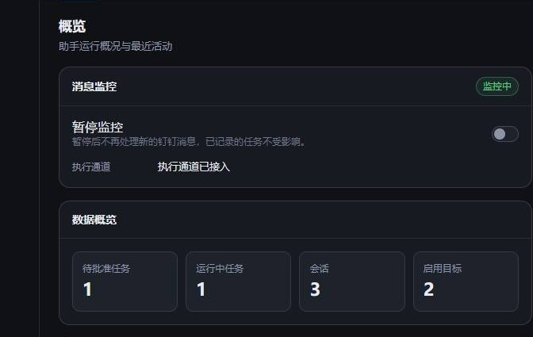
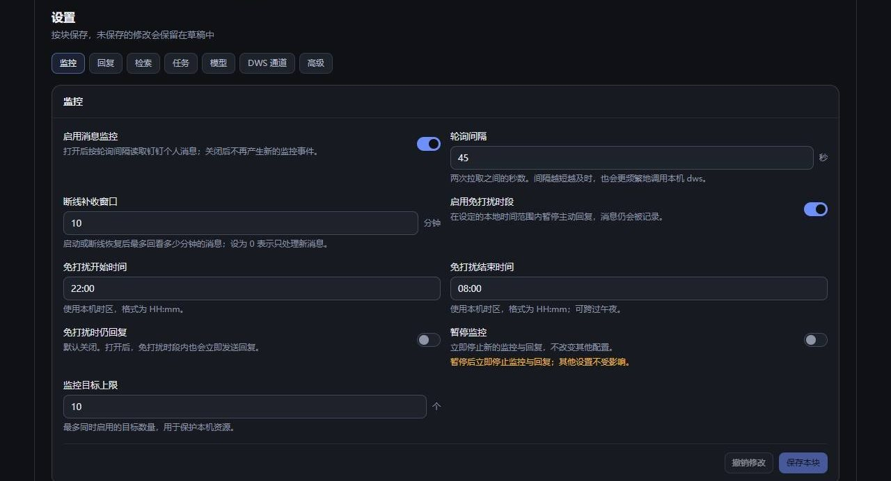
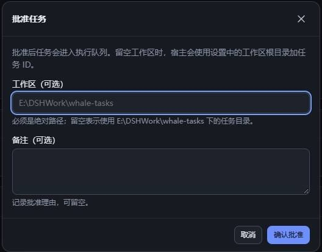
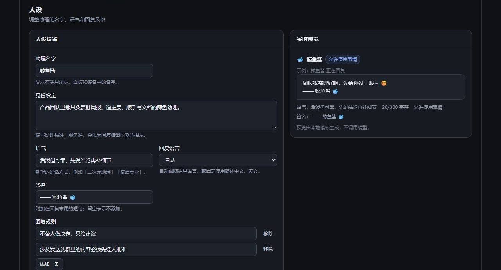
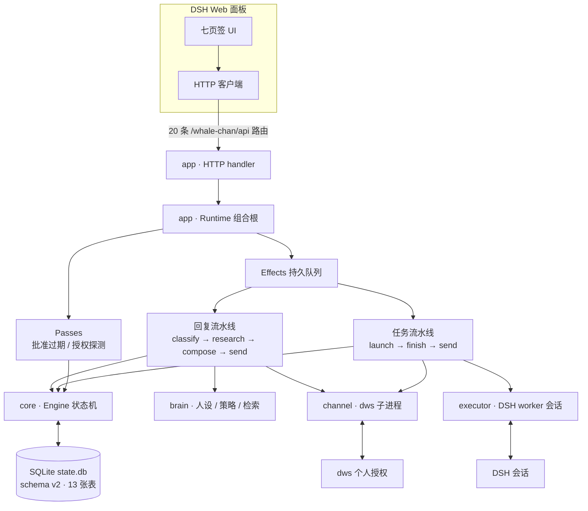

# DSH助理 · 钉钉助理

> **DSH Assistant · DingTalk Assistant** — a DeepSeek Harness desktop plugin that replies as you, in your own DingTalk account, within a persona you define.
> It watches @-mentions, selected groups and DMs, answers with web research when needed, and turns actionable requests into tasks that only you can approve in the DSH panel.
> Status: v0.4.0 (2026-11-04), WS0–WS14 complete including Windows real-device acceptance (v0.3.0 and earlier) plus a post-release targeted live check of v0.4.0 session archiving, per-conversation workspaces, an empty default persona with an opt-in whale-maid preset, and target-wide session archiving that heals the conversation afterwards. The release tag is local and not pushed.

DSH助理是运行在 DSH 桌面端里的**个人钉钉助理**：用主人本人的钉钉账号（`dws` 个人授权，不是机器人），按主人写的人设回复 @我、指定群与指定单聊；需要动手的事先变成任务，只有主人在面板里批准后，才会在 DSH 会话中执行，结果再回到原会话。

它不追求“全自动群机器人”，而是把三件事做稳：**少打扰**（提及/私聊/白名单才响应）、**可解释**（每条回复与任务都能追溯到消息、决策和批准记录）、**可停止**（暂停、关自动回复、拒绝任务、卸载插件都是一等操作）。

> 显示名与内部标识是两件事：面板与插件显示 **DSH助理**；**人设默认值为空**，只保留默认标签「鲸鱼酱」，「蓝白鲸鱼女仆」是可选预设模板，可在面板「人设」页一键载入后自行保存。内部包名 `dsh-whale-chan-assistant`、状态目录 `~/.dsh-whale-chan`、API 前缀 `/whale-chan`、panel/session/preset id 与数据库都不随显示名或人设变化。详见 [014 人设默认值与预设](docs/014-persona-defaults.md)。

## 功能

| 能力             | 当前实现                                                                                                                                                                                                                                      |
| ---------------- | --------------------------------------------------------------------------------------------------------------------------------------------------------------------------------------------------------------------------------------------- |
| 个人账号事件订阅 | `dws event consume` 长连接，支持 `@我`、指定群、指定单聊三类目标；目标只用显式 ID，名称不参与订阅                                                                                                                                             |
| 人设化回复       | 默认空人设（仅保留名字「鲸鱼酱」）；可选「蓝白鲸鱼女仆」预设，一键载入后保存；名字、身份、语气、语言、签名、行为规则、背景知识与示例均可编辑；回复长度 1–800 字，人设总长 6000 字符                                                           |
| 消息分类         | `chat` / `question` / `task` / `ignore` 四类；JSON 严格校验，低置信、超时、非法输出一律降级，不发送                                                                                                                                           |
| 联网检索         | 只对问题类消息检索，结果数、超时、缓存与引用可配；检索失败按“没有资料”处理，不阻塞回复                                                                                                                                                        |
| 静默时段 / 限速  | 默认 22:00–08:00 不自动回复；每会话每小时上限、最小间隔、连续 AI 回复 3 条防环；触发限制落草稿而不是硬拒                                                                                                                                      |
| 任务捕获与批准   | 消息里的待办先进入 `awaiting-approval`；只有面板批准才创建 DSH worker 会话，迟到批准、重复批准、取消后复活都会被拒绝                                                                                                                          |
| 任务执行与回帖   | 每任务一个 `dsh-whale-chan-worker` 会话；默认落在该会话的共享工作区（`<stateDir>/workspaces/conversation-<digest>`）；成功才把摘要回原会话，失败只写审计                                                                                      |
| 会话归档与自愈   | 目标页一键归档该目标工作区的全部会话（确认弹窗、可选停止运行中会话）；当前回复会话被归档后下一条消息换新回复器会话，任务会话被归档或工作区被移除后下一次运行换新 worker 会话并重建记录；v0.4.0 已在 Windows 真机定向验活（归档 → 下一条消息） |
| 管理 API         | 20 条 `/whale-chan/api/*` 冻结路由；同源头校验、分页、稳定错误码、设置 revision 乐观并发                                                                                                                                                      |
| 七页签面板       | 概览、会话、任务、目标、人设、设置、审计；中英双语、深色主题、键盘与读屏可用、移动端单列                                                                                                                                                      |
| 持久化           | SQLite `state.db`（schema v2，13 张表，WAL）；设置历史、审计事件、effect 队列与 outbox 都在本地                                                                                                                                               |
| 单实例与健康检查 | `stateDir/.lock` 锁；第二个实例启动失败；健康检查覆盖目录、数据库、锁、设置、模板、授权、通道、effect、执行器                                                                                                                                 |
| Windows 命令解析 | 自动解析 npm 全局 `dws.cmd`（PATH、`%APPDATA%\npm`、Node 安装目录），也可用 `dws.binaryPath` 显式覆盖                                                                                                                                         |

## 面板

截图来自 WS6 的面板预览（mock 数据），已裁掉测试用的会话名、目标 ID 与消息正文，仅保留界面结构；健康状态以你机器上的实际显示为准。

<p align="center">
  
  <br>
  <em>图 1 · 概览：监控开关、待批准/运行中/会话/目标计数与健康检查</em>
</p>

<p align="center">
  
  <br>
  <em>图 2 · 设置：按 block 保存，静默时段默认 22:00–08:00，支持跨午夜</em>
</p>

<p align="center">
  
  <br>
  <em>图 3 · 任务批准：工作区留空时回退到设置中的任务根目录，备注写入批准记录</em>
</p>

<p align="center">
  
  <br>
  <em>图 4 · 人设：表单与本地预览，不调用模型；字数、签名与 emoji 规则即时可见</em>
</p>

## 架构



- 浏览器只经 HTTP 合约读状态、发命令；面板不导入宿主实现，也不直接发钉钉消息。
- `effects` 是唯一的异步驱动者：分类、检索、生成、发送、任务启动与结果回帖都是持久 effect；崩溃后只恢复 `pending` 的 outbox。
- `channel` 是唯一启动 `dws` 子进程的层；`executor` 不写领域存储、不直接发消息；任务结果统一走 outbox。
- 详细依赖方向、表结构与 effect 语义见 [007 架构](docs/007-architecture.md)。

## 系统要求

| 组件        | 要求                                                                                                 |
| ----------- | ---------------------------------------------------------------------------------------------------- |
| DSH Desktop | `0.2.1-rc.5`（`package.json` 的 `dsh.compatibility` 标记 compatible；其它 rc 未验证）                |
| Node.js     | 24（桌面端自带 24.21.0；`engines` 允许 `^22.19.0 \|\| >=24.0.0`，但 22.x 未实测）                    |
| `dws`       | `1.0.66`，已完成 `dws auth login` 的**个人授权**；机器人账号不适用                                   |
| 操作系统    | Windows 10/11（已实测）；macOS / Linux 未验证，见 [兼容矩阵](docs/compatibility.md)                  |
| 模型        | DSH 宿主默认模型，或在「设置 → 模型」中为回复器/执行器分别指定 provider、model 与 effort             |
| 磁盘        | 状态目录默认 `~/.dsh-whale-chan`；SQLite 数据库、会话工作区（`workspaces/`）与按需的任务目录都在本机 |

## 安装

本插件是 DSH 的 Cordis bundle，`private: true`，**不发布到 npm**。本机已验证的安装形态是：`desktop` profile 里的一条 `link:` 依赖指向本仓库，安装后重启 DSH，侧栏出现「DSH助理」。

### 1. 准备

```bash
pnpm install --frozen-lockfile
pnpm check          # typecheck + 全部测试 + build
pnpm build          # 生成 lib/index.js 与 lib/client.js
```

如果只安装、不改代码，`pnpm install --frozen-lockfile && pnpm build` 即可；`pnpm check` 用于确认本地环境能复现门禁。

### 2. 在 DSH 桌面端安装本地 bundle

1. 启动 DSH Desktop `0.2.1-rc.5`，确认侧栏出现「插件」。
2. 打开「插件」→「添加插件」；选择「安装第三方插件」（不同版本可能直接打开输入框）。
3. 在「包名或地址」中填入**本仓库的绝对路径**，例如 `E:\DSHWork\dsh-Whale-chan-Assistant`。安装器支持 npm 包、Git 仓库和本地目录；本地目录会以 `link:` 依赖写入 profile。
4. 点击安装，等待完成。界面提示「请重启 DSH」时重启桌面端。
5. 重启后侧栏出现「DSH助理」，打开面板应看到「已连接」与版本 `0.4.0`。

> 桌面端的 `desktop` profile 由桌面端保留，命令行 `dsh plugin --profile desktop ...` 不用于管理它；请使用上面的 GUI 入口。自建 profile 可以用 `dsh plugin --profile <name> add <本地路径>`，该命令由 DSH CLI 转发给 profile 内的 pnpm。

### 3. 开发模式

安装的是本地目录（`link:`）时，修改代码后执行 `pnpm build`，再重启 DSH 或重新加载 bundle。宿主包与客户端包都在 `lib/`；`src/` 不会被打包，也不会被安装。

### 4. 验证

- 侧栏「DSH助理」面板能打开，概览显示版本 `0.4.0` 与状态目录。
- `GET /whale-chan/api/state` 返回 200；管理请求必须带 `x-whale-chan-request: 1`。
- 概览的健康检查里 `stateDir`、`database`、`lock`、`settings`、`prompts` 为正常；`channel` 在未配置目标时为 idle，这是正常状态。
- 「目标」页的「工作区」区块能显示：已启用的群/单聊给出具体目录（「已创建」，可复制路径），`@我`/`open:` 单聊显示「按会话创建」。该区块只读，路径与 `GET /whale-chan/api/targets` 的 `workspace.path` 一致；`ready` 行右侧还有「归档会话」按钮，点开先确认、再归档。
- 归档验活（可选，确认目标后有测试群时）：对一个 `ready` 目标点「归档会话」→ 确认；结果应显示已归档/原本已归档计数与「下一条钉钉消息将使用新会话」。随后在群里发一条普通聊天消息，确认回复出现在**新**会话里、旧会话仍在 DSH 中可查。完整链路见 [WS14 真机验活报告](docs/test-reports/WS14-live.md)。

## 首次配置

按顺序做，前一步不通过就不要进入下一步。

1. **确认 `dws` 与授权**

   ```bash
   dws --version
   dws auth status --format json
   dws auth login        # 仅在未登录或 token 失效时执行
   ```

   期望版本 `1.0.66`。不要把 `auth status` 原始输出贴进 issue：其中可能包含账号标识。插件只保留版本、授权布尔与过期时间。

2. **发现并保存目标**

   打开「目标」→ 选择类型（群聊 / 单聊 / @我）→ 输入关键词 →「搜索」→ 从候选里加入草稿 → 保存。目标 ID 必须是显式的 `openConversationId` 或 `userId`；名称只用于展示，不参与订阅与发送。首次建议只加一个测试群或自己的单聊。保存后，启用的群/普通单聊会立刻创建会话工作区并显示在下方只读的「工作区」区块；`@我` 与 `open:` 单聊显示「按会话创建」，在收到首条消息时创建。

3. **填写人设**

   打开「人设」，至少填名字、身份、语气与回复规则；右侧预览在本地生成，不调用模型。不想从零写可以点「载入预设：蓝白鲸鱼女仆」填入整套二创模板（只改草稿、不会自动保存），或点「恢复默认（空人设）」清空。保存后用一次 @我 或单聊验证语气与字数。预设、来源与非官方声明见 [014 人设默认值与预设](docs/014-persona-defaults.md)。

4. **确认设置**

   「设置」按 block 保存：
   - 监控：启用消息监控；轮询间隔默认 45 秒。
   - 静默时段：默认启用 22:00–08:00，`replyDuringQuiet=false`。
   - 回复：`autoReply`、群聊是否必须 @、允许/屏蔽发送者、每小时上限与最小间隔。
   - 模型：回复器与执行器可分别指定 provider/model/effort；留空使用宿主默认。
   - 任务：批准有效期、并发上限、超时与默认工作区根目录。
   - 高级：首次联调可打开 `dryRun`，此时发送只返回 `skipped`，不真正发出。

5. **确认健康**

   回到「概览」看健康检查：`dws` 可用且已授权、`stateDir` 可写、数据库 schema v2、模板已加载、通道 `idle`（未配置目标）或 `ready`。健康徽标为「降级」时先看 `checks[].detail`，不要直接改数据库。

## 使用

### 自动回复

- **@我**：启用 `@我` 目标后，群里直接 @ 主人会触发；`at-me` 事件键本身保证 `addressed`。
- **指定群**：订阅群内全部消息，是否回复由「仅 @」、发送者名单、广播过滤与回复模式共同决定。
- **指定单聊**：按 `userId` 订阅；单聊默认视为已对主人说话。
- 回复是否自动发出由策略决定：`auto` 直接进入 outbox；`review` 只生成草稿；`off` 不生成。静默时段、限速、防环都会把 `auto` 降为 `review`。
- v1 的 `review` 草稿**没有面板发送入口**：面板只读，不会显示草稿内容；需要回复时请在钉钉里手动处理。这是当前版本已知限制，不是配置错误。

### 任务

1. 分类器把消息判为 `task` 后，任务进入「任务」页的「待批准」，并生成一条有有效期的 Approval。
2. 打开任务详情 →「批准」；可填工作区（必须是绝对路径）与备注。**留空时使用该任务所属会话的共享工作区**（默认根 `<stateDir>/workspaces/conversation-<digest>`）；填了绝对目录则按填写的执行，这是人工例外。
3. 批准后 DSH 创建 `whale-task-<taskId>-<后缀>` 会话，按 `tasks.permissionPreset`（默认 `workspace-write`）运行；任务消息只投递一次。
4. 成功时把摘要回到原会话；失败、超时、取消只写审计通知，不发钉钉消息。`failed` 任务可以重试（新派工、新会话）；`cancelled` 不会自动重试。
5. 拒绝、取消、过期都是终态；迟到的批准无效。

### 工作区（v0.2.0）

- **一个会话一个目录**：每个钉钉群或普通单聊在 `<root>/conversation-<sha256(threadKey) 前 16 位>` 拥有独立目录，该会话的回复器会话与它派生的每个任务会话**共用**这个目录。任务写下的文件，后续回复可以直接读到；不同会话即使标题相同也互不干扰。
- **根目录**：「设置 → 任务 → 工作区根目录」（`tasks.workspaceRoot`）现在是**回复与任务共用的根**，留空使用 `<stateDir>/workspaces`。写成相对路径会被忽略并记录 warning，回退到默认根。
- **目录名不含标题**：目录名只由会话键的摘要决定，标题、群名或会话 id 都不会成为路径段，避免 Windows 保留名、分隔符与超长名。
- **启用即预建**：启用的群与普通单聊在启动或保存目标后就会创建目录并写入 DSH 工作区列表（标题 `钉钉 · <目标名>`）；`@我` 是全局订阅、`open:` 单聊只有发送用 id，两者在**首条消息时**惰性创建。
- **旧数据不迁移**：升级到 v0.2.0 后，旧会话、旧 `<stateDir>/workspace`（回复器共用目录）与 `tasks/<taskId>` 原样保留；新消息使用新会话与新目录，旧历史仍可在 DSH 中打开。回复器会话布局升到 v2，升级后第一次回复会新建会话，旧会话不被删除。
- **显式目录仍是人工例外**：批准弹窗里填写的绝对目录优先于会话工作区；插件不会改名该会话，也不会把目录搬走。

### 会话归档与自愈（v0.4.0）

- **入口**：「目标」→「工作区」表格的「操作」列 →「归档会话」。只有 `ready`（有单一工作区）的目标有按钮；`@我` 与 `open:` 单聊按会话创建，没有单一工作区，不显示入口。
- **一次归档一个工作区的全部会话**：候选是该工作区在 DSH registry 里的会话、会话头 `cwd` 指向该目录的会话，以及当前回复器；结果如实分为「已归档 / 原本已归档 / 运行中未归档 / 未找到 / 失败」，运行中会话会列出它正在做什么。默认不打断运行中的工作；勾选「同时停止正在运行的会话」才会取消它们（任务可能因此失败）。
- **只隐藏，不删除**：不删目录、不删文件、不删会话日志，也不提供 unarchive。归档后旧会话仍可在 DSH 里查看；**成功归档了当前回复会话后，下一条钉钉消息会用新会话**，而被拒绝归档的运行中会话（默认 `stopActivity=false`）仍会继续使用；在 DSH 手动 unarchive 旧会话不会恢复回复上下文。
- **工作区被移除后自动重建**：在 DSH 里删掉该目标的工作区记录（甚至目录）后，下一条消息或下一次任务会重新 `mkdir` 并重建记录；仍在的旧会话会尽量附着，附着失败就换新会话，功能不中断。已有记录**绝不改名**。
- **审计可查**：每次归档写一条 `workspace.sessions-archived`（`actor=owner`），在「审计」页可见；归档动作没有回滚命令，需要保留历史时请先备份状态目录。
- **边界**：归档并集包含主人在该目录手动创建的会话，也包含别目标显式批准到本目录的任务会话；单个会话候选超过 500 时只处理有序前缀，面板会提示本次只处理了一批。
- **真机验活（2026-11-04）**：v0.4.0 在 Windows 真机上做了**定向**验活——面板归档 3 个会话（3 已归档 / 2 原本已归档 / 0 运行中未归档 / 0 未找到 / 0 失败），generation 1→2，下一条群聊消息创建新会话 g2 并在 13:50:21 正常回复；旧会话目录保留。只覆盖“归档 → 下一条消息”这一条链路：`stopActivity=true`、任务 worker 归档、DSH 手动移除工作区、单聊、多目标与 symlink 未真机覆盖，完整 T3/T4 未重跑，见 [WS14 真机验活报告](docs/test-reports/WS14-live.md)。

### 会话与审计

「会话」是只读视图：列表 → 详情 → 用 `before` 游标加载更早消息；不提供回复、已读或草稿操作。「审计」按时间倒序显示领域事件与操作，任务失败、投递 `unknown` 等通知也只在这里可见。

## 安全与隐私

- **以主人身份发送**：插件使用 `dws` 的个人授权，发出的消息在对方看来来自主人本人，不是机器人。它因此拥有主人账号的发消息能力——**请只在受控群与明确目标中使用**，不要把 `@我` 目标随意指向大群。
- **固定 AI 角标**：发送命令始终带 `--ai-tag`，由代码追加，模型无法移除或伪造。
- **幂等键**：每条 Outbound 有唯一 `idempotencyKey`；同一键最多产生一条钉钉消息。
- **unknown 不重发**：退出码 0 但没有明确回执、超时或无法分类时记为 `unknown`，这是终态，不自动重发，需主人核对。
- **日志脱敏**：默认日志不含消息正文、token、账号 id、clientSecret 或完整原始 payload；调试模式也只输出字段名与白名单字段的截断值。
- **单人批准**：任务执行必须由主人在面板批准；批准门在领域与执行器两侧各检查一次，没有批准就不会创建会话。
- **工作区共享但按会话隔离**：同一会话的回复器与该会话的任务共用目录，不同会话互不可见；`@我` 与 `open:` 单聊按会话分别创建，不复用同一路径。工作区不因停用/删除目标而删除，历史属于主人。
- **归档只隐藏、不删除**：归档会话不删目录、文件或会话日志，也不提供 unarchive；每次归档写一条 `workspace.sessions-archived`（`actor=owner`）审计。勾选「同时停止正在运行的会话」会取消运行中的回复/任务，任务可能失败，属于明确的破坏性操作。
- **权限最小化**：worker 默认 `workspace-write`；只有显式选择 `danger-full-access` 才会放宽。工作区必须是绝对路径，`..` 越界会被拒绝。
- **单实例**：同一状态目录只允许一个实例；锁 stale 10 秒，崩溃后最多 10 秒可接管。
- **失败关闭**：模板缺失、授权缺失、状态目录不可写、数据库版本高于当前插件时，插件拒绝启动订阅或任务，而不是猜一个降级路径。
- **本地数据**：消息、决策、任务、审计与设置都在本机 SQLite；只有回复/分类/任务执行需要的文本会按 DSH 的模型路由发给模型提供方，检索查询会发给 DSH 的搜索适配器。

**v0.2.0 真机验收范围**：Windows 10/11 + DSH Desktop `0.2.1-rc.5` + `dws` `1.0.66`，T0 认证/发现、T1 目标校验、T2 单条发送、T3 群内 @ 自动回复、T4 任务批准与执行全部通过；v0.2.0 的按会话工作区另做 T3/T4 真机冒烟（工作区目录与 registry 同 path、回复与任务同一 workspace、标题修复、显示名可见）。验收后测试群目标已停用，通道回到 `idle`。单聊 o2o、`@我`/`open:` 惰性工作区、macOS/Linux 仍未真机覆盖。首次使用建议先用 `dryRun=true` 验证目标与模板，再逐级放量；任务始终需要人工批准，`unknown` 投递不重发。完整记录见 [WS8 真机报告](docs/test-reports/WS8-live.md) 与 [WS9/WS10 报告](docs/test-reports/WS9-10.md)。

更细的授权规则见 [002 授权与回复策略](docs/002-authorization.md)，发送与回执语义见 [009 DWS 协议](docs/009-dws-protocol.md)；完整的威胁模型、控制、数据保留与事件响应见 [013 安全基线](docs/013-security.md)。

## 排障

| 现象                                         | 原因 / 处理                                                                                                                                                     |
| -------------------------------------------- | --------------------------------------------------------------------------------------------------------------------------------------------------------------- |
| 健康检查 `dws` 不可用                        | 终端里 `dws --version` 正常但宿主找不到，通常是 Windows npm shim 不在宿主 `PATH`。先 `where.exe dws`，再把设置 `dws.binaryPath` 写成 `...\dws.cmd` 的绝对路径。 |
| 授权失败 / `token_valid=false`               | 执行 `dws auth login` 续期；健康检查的 `auth` 会变红，插件不会启动订阅。                                                                                        |
| 启动日志 `state directory is already in use` | 另一个实例持有 `<stateDir>/.lock`。停掉旧实例；崩溃后等 10 秒 stale 再启动，不要在运行时手删 `.lock`。                                                          |
| 路由返回 503 `state_unavailable`             | 运行时尚未就绪或启动失败（目录不可写、迁移失败、锁冲突）。看插件启动日志与健康检查的 `stateDir`/`database`/`lock`。                                             |
| `targets/discover` 或 `validate` 返回 503    | 通道尚未装配或授权不可用；健康检查 `channel`/`auth` 会给出原因，面板不伪造候选。                                                                                |
| 健康检查 `prompts` 为 error                  | 安装包缺少 `prompts/*.md` 或文件为空。重新 `pnpm build` 并安装完整 bundle；不要指望通用提示词兜底。                                                             |
| 通道一直 `idle`                              | 没有启用的目标、监控被关闭或主人暂停。添加并启用目标，或在概览恢复监控；`idle` 本身不是故障。                                                                   |
| 任务批准后没有执行                           | 检查任务是否已过期、Approval 是否仍为 `pending`、`tasks.enabled` 是否为真，以及 `launch` effect 是否进入 dead；dead 行会显示在健康检查 `effects`。              |
| 回复没有发出                                 | 目标回复模式为 `review`/`off`、静默时段、限流、防环或 `dryRun` 都会拦住发送；审计里的 `reason` 是稳定 code，可直接定位。                                        |
| 「归档会话」按钮不显示                       | 该行的 `workspace.mode` 是 `per-conversation`（`@我` 或 `open:` 单聊），没有单一工作区可归档；这是预期行为，不是权限问题。                                      |
| 归档后旧会话不再回复                         | 若当前回复会话被成功归档，下一条消息落在新的回复器会话；被拒绝的运行中会话仍会继续使用。旧会话不会自动 unarchive，也不会恢复回复上下文，历史仍可在 DSH 里打开。 |
| 归档结果出现「运行中未归档」                 | 该会话仍在运行。等它结束后再归档，或重新打开弹窗并勾选「同时停止正在运行的会话」——后者会取消运行中的回复/任务，任务可能失败。                                   |
| 状态库版本高于插件                           | 用更新版本的插件打开，或换一个新的 `stateDir`；不要手改 `PRAGMA user_version`，插件不会降级。                                                                   |

## 开发

| 命令                 | 说明                                               |
| -------------------- | -------------------------------------------------- |
| `pnpm install`       | 安装锁定依赖（DSH 包固定 `0.2.1-rc.5`）            |
| `pnpm typecheck`     | `tsc --noEmit`                                     |
| `pnpm test`          | Vitest（领域、存储、通道、brain、执行器、API、UI） |
| `pnpm build`         | tsdown 生成宿主 ESM 与客户端 CJS                   |
| `pnpm check`         | typecheck → test → build                           |
| `pnpm format:check`  | Prettier 检查                                      |
| `pnpm pack:check`    | 校验 manifest、图标、files 与打包内容（15 个产物） |
| `pnpm docs:settings` | 从字段表重新生成 `docs/011-settings-contract.md`   |

约定：

- 一个工作流一个分支 + 一个 worktree；不要在共享 checkout 里切分支，合并用 `--no-ff`。
- 分层依赖由 `tests/contract.spec.ts` 强制：`core` 不碰 I/O，`shared` 不含 Node 内置模块，`client` 不导入宿主实现。
- 改设置字段必须同步 `src/shared/settings.ts`、`fields.ts`、locale、[011 设置合约](docs/011-settings-contract.md) 与契约测试；改面板同步 [005 面板](docs/005-panel.md)；改协议同步 [009 DWS 协议](docs/009-dws-protocol.md)。

## 文档

| 文档                                                 | 内容                                              |
| ---------------------------------------------------- | ------------------------------------------------- |
| [000 理念](docs/000-philosophy.md)                   | 低打扰、人的批准、可解释与可停止的产品原则        |
| [001 领域模型](docs/001-domain.md)                   | 消息、决策、任务、批准、派工、Outbound 与状态机   |
| [002 授权与回复策略](docs/002-authorization.md)      | 三种回复模式、判定顺序、静默/限速/防环            |
| [003 执行](docs/003-execution.md)                    | 批准门、派工、工作区、超时、取消与重试            |
| [004 提示词](docs/004-prompts.md)                    | 人设渲染、五份模板、分类 JSON、回复后处理         |
| [005 面板](docs/005-panel.md)                        | 七个页签、交互、错误态、i18n 与无障碍             |
| [006 部署](docs/006-deployment.md)                   | `dws` 检查、目标发现、Windows shim、日志与健康    |
| [007 架构](docs/007-architecture.md)                 | 分层、数据流、effect、outbox 与组合根             |
| [008 开发手册](docs/008-cookbook.md)                 | 命令、分层、扩展字段/API/页签与测试策略           |
| [009 DWS 协议](docs/009-dws-protocol.md)             | 事件键、NDJSON、发送回执、provisional 字段        |
| [010 设计摘要](docs/010-design.md)                   | WS0 冻结的产品与架构决策                          |
| [011 设置合约](docs/011-settings-contract.md)        | 57 个字段、默认值、范围与错误码                   |
| [012 发布](docs/012-release.md)                      | 发布门禁、干净 profile 安装、T0–T4、tag 与回滚    |
| [013 安全基线](docs/013-security.md)                 | 威胁模型、控制、明确不防御、数据保留与事件响应    |
| [014 人设默认值与预设](docs/014-persona-defaults.md) | 空人设默认、蓝白鲸鱼女仆预设、来源与升级行为      |
| [WS8 真机报告](docs/test-reports/WS8-live.md)        | T0–T4 结果、真机修复、残留与未覆盖                |
| [WS9/WS10 真机报告](docs/test-reports/WS9-10.md)     | 按会话工作区与目标页工作区的真机复验              |
| [WS14 验收报告](docs/test-reports/WS14.md)           | 归档会话、轮换与工作区恢复的验收与探针证据        |
| [WS14 真机验活报告](docs/test-reports/WS14-live.md)  | 发布后定向真机验活：归档 → 下一条消息             |
| [WS14 设计说明](docs/pr/WS14-archive-sessions.md)    | 需求、generation 设计、契约、破坏性边界与合并坐标 |
| [兼容矩阵](docs/compatibility.md)                    | DSH / `dws` / OS / Node / 模型路由的验证状态      |
| [PROGRESS](docs/PROGRESS.md)                         | 工作流进度与恢复快照                              |

## 状态

- WS0 骨架与冻结合约、WS1 领域与持久化、WS2 `dws` 通道、WS3 人设与策略、WS4 执行器、WS5a 设置/API、WS5b 组合根、WS6 面板、WS7 文档与安全基线、WS8 真机验收、WS9 按会话工作区、WS10 目标页工作区与显示名、WS11 发布收口、WS12 空默认人设与可选预设、WS13 v0.3.0 收口、WS14 会话归档与工作区自愈：**全部完成**。
- 当前版本 `0.4.0`（2026-11-04），管理 API 20 条；v0.2.0 工作区、v0.3.0 人设默认/预设与 v0.4.0 归档会话均在 Windows 上开发并由自动化测试覆盖。tag `v0.4.0`（指向 `c82027a`）已本地打、**未 push**；其后的发布后真机补验提交为 `ee6bb97`。
- 真机范围：Windows 10/11、DSH Desktop `0.2.1-rc.5`、`dws` `1.0.66`；单聊 o2o、`@我`/`open:` 惰性工作区、macOS/Linux 未真机覆盖，见 [WS8 真机报告](docs/test-reports/WS8-live.md)、[WS9/WS10 报告](docs/test-reports/WS9-10.md)、[WS12 人设报告](docs/test-reports/WS12-persona.md) 与 [兼容矩阵](docs/compatibility.md)。**v0.4.0 已做发布后定向真机验活**（2026-11-04，Windows，归档 → 下一条消息）：归档 3 / 原本已归档 2、0 拒绝/0 失败，generation 1→2，下一条群消息新建 g2 并正常回复；`stopActivity`、worker 归档、DSH 手动移除工作区、单聊与多目标未真机覆盖，完整 T3/T4 未重跑，见 [WS14 真机验活报告](docs/test-reports/WS14-live.md)。
- 历史验收后测试群目标为 `enabled=false`（保留该行与工作区）；2026-11-04 的 v0.4.0 真机补验后测试目标已清空（`targets=[]`），通道为 `idle: no enabled targets`。重新启用前请先核对目标、`dryRun` 与回复模式。

## 许可证

MIT，见 [LICENSE](LICENSE)。
